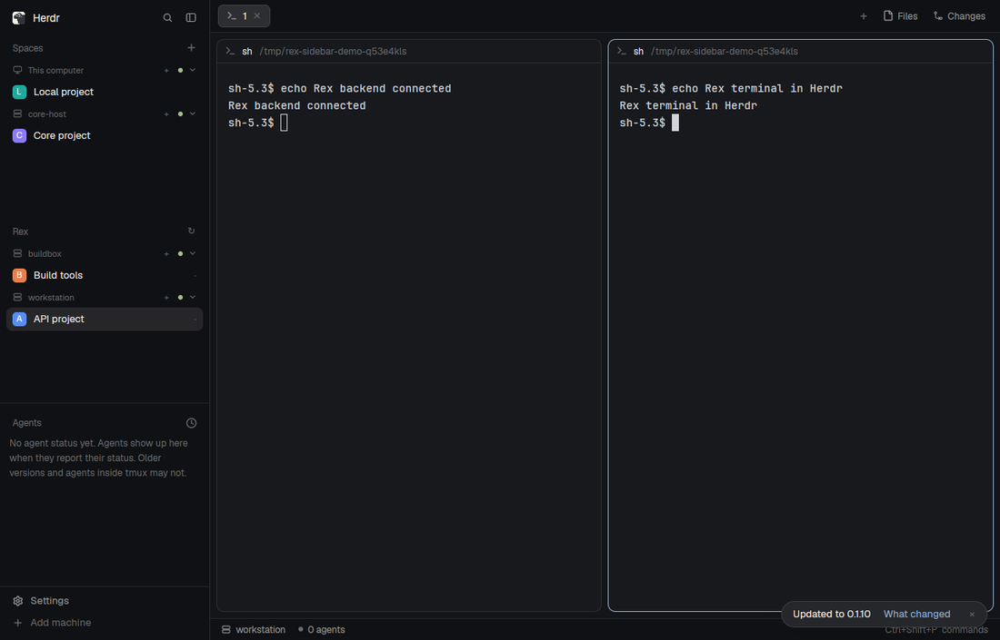

# Rex servers for Herdr

A Rex section in Herdr's sidebar. Each server has a connection indicator,
collapsible space list, and a **+** action for creating a space. Selecting a
space opens its Rex terminals in Herdr's normal tabs and panes.



The package includes two sidebar views and the external bridge that connects
Herdr's existing machine protocol to Rex. It works with stock Herdr and keeps
local/SSH machines in Spaces while Rex servers appear in their own section.

## What it does

- Lists multiple Rex servers with the same compact header and avatar-row style
  as Herdr's machine groups.
- Shows connected, connecting and unavailable states; remembers folded servers.
- Selects spaces on click, opens their normal context menu on right-click, and
  creates a space with a connected server's **+** action.
- Follows Herdr's theme and adapts to a narrow sidebar.
- Keeps ordinary Spaces features—local/SSH machines, repo information, worktree
  grouping, menus and ordering—in a separate Spaces view.
- Uses Rex sessions, windows and terminal blocks as Herdr spaces, tabs and panes.
  Layout changes are shared with other Rex clients.
- Preserves native terminal output, input, resize, focus and reconnect repaint.
- Keeps Herdr mod panes anchored beside Rex terminals across server updates
  and bridge reconnects, without creating extra Rex terminals.

## Install with your agent

Ask your agent to install this package into your existing sidebar and connect
your Rex endpoint. [RECIPE.md](RECIPE.md) describes the complete setup and how
to rebuild it from an empty folder. The agent should:

1. Read the package and disclose the helper's program, file and network access.
2. Build the bridge and put its executable at a stable absolute path.
3. Register each endpoint with hc's existing machine transport.
4. Copy both folders from `mods/`, preserving existing mods on name collisions.
5. In your personal layout, point the Spaces block at `rex-bridge-spaces` and
   add a `rex-bridge` block immediately beneath it in the same sidebar column.
   Clone a shipped layout before changing it; keep your other panels and look.
6. Run Herdr's checker on both mods and verify the live sidebar.

The folders contain `mod.json` with `place: none`: the installing agent chooses
where they fit. No layout is shipped and no custom key bindings are required.
The shared provider list keeps Rex out of Spaces, so each server appears once.
The sidebar itself neither installs programs nor connects new servers silently.

## Build and connect manually

Requires Rust, **Zig 0.16.0**, Clang/libclang, an installed herdr-core with `--via`
support, and an existing Rex server that authorizes this machine.

```sh
git clone --recurse-submodules https://github.com/yycholla/herdr-rex-bridge.git
cd herdr-rex-bridge
cargo build --locked
```

Set `ZIG` to the Zig 0.16.0 executable if your default version differs. Register
an endpoint with a unique lowercase machine name and the bridge's absolute path:

```sh
hc machine add --name workstation --via '/absolute/path/herdr-rex-bridge --server unix:///run/user/1000/rex/server.sock via'
```

For another server, use another name and its `wss://host:port` endpoint. `ws://`
is also supported for listeners you intend to reach without TLS. Rex controls
authorization. Register each endpoint once. Refresh the Rex section after adding
a server, or let its 15-second connection refresh pick it up.

The JavaScript views use the external executable only through the normal core
registration. Keep the binary at that path. The bridge needs no GPUI or Herdr
source tree at runtime. Do not change Herdr's backend or core setting.

To remove a registration, use `hc machine rm <name>`. This disconnects the
bridge without asking Rex to close its sessions. To remove the sidebar package,
restore the Spaces block to `spaces` and remove the Rex block from your personal
layout before deleting the two mod folders.

## Package and data

```text
mods/rex-bridge/          Rex server and space sidebar
mods/rex-bridge-spaces/   Spaces view that leaves Rex to its own section
RECIPE.md                reconstruction and installation brief
preview.png              actual isolated Herdr screenshot
src/, crates/, vendor/   standalone bridge source and pinned Ghostty
```

`rex-bridge` accepts optional `machine` props to show one registered server;
by default it shows all Rex bridge servers. It shares their names under
`rex-bridge.servers`; the Spaces view uses that list for filtering. Server folds
are stored per mod copy. It reads live spaces and shared avatar colors from
Herdr, and calls `hc machine ls --json` for connection details.

The bridge sends terminal input and layout commands to Rex, reads its sessions
and terminal streams, and keeps endpoint-specific alias/layout metadata under
`$XDG_STATE_HOME/herdr-rex-bridge`, otherwise `~/.local/state/herdr-rex-bridge`.
`--state-dir` overrides that location. The Spaces view also performs the same
repo reads and git commands as Herdr's standard Spaces mod. No account credentials
are bundled, and the screenshot uses private test servers and synthetic data.

## Limits

- Linux is tested. macOS is untested; hc's `--via` transport currently rejects
  Windows. The sidebar requires the bridge's supported Rex API revision 7.
- Kitty images, remote file/git operations over the bridge, Rex floating layers,
  non-terminal blocks and Lua client keys/actions are not implemented. Existing
  Rex non-terminal blocks are preserved.
- A Herdr mod in a Rex tab needs a terminal anchor. Use a local mod tab for a
  standalone canvas; removing its anchor hides the mod.
- Register one core connection per Rex endpoint. Multiple independent cores
  writing the same bridge metadata are not supported.
- Unsupported protocol operations return errors. The wire version denotes hc
  compatibility; `bridge_version` identifies this program.

## Validate

```sh
cargo test --locked
cargo build --locked
python3 tests/smoke.py
herdr-app check mods/rex-bridge
herdr-app check mods/rex-bridge-spaces
```

The real-server smoke test uses temporary Rex/core sessions and data. For a
headless sidebar test and fresh screenshot, install Herdr's sandbox dependencies
(Weston, Xwayland, uv and ImageMagick) and use a clean Herdr checkout/binary:

```sh
HERDR_ORIGIN_WORKTREE=/path/to/herdr-app \
HERDR_ORIGIN_BIN=/path/to/stock/herdr-app \
python3 tests/mod_ui_smoke.py
```

Pass `CARGO_TARGET_DIR` if that checkout uses a shared build directory. The test
starts two private Rex servers and a normal private core, checks separate groups,
native terminal actions and narrow mode, saves `preview.png`, then stops only its
own fixtures. `tests/ui_smoke.py` checks terminal splitting; the additional mod-pane
regression test checks persistence across server updates and reconnects.

Verified against Herdr 0.1.10 (`07ba77e`), hc 0.1.14 and Rex API revision 7.
Source attribution and the Apache-2.0 license are in NOTICE and LICENSE.
