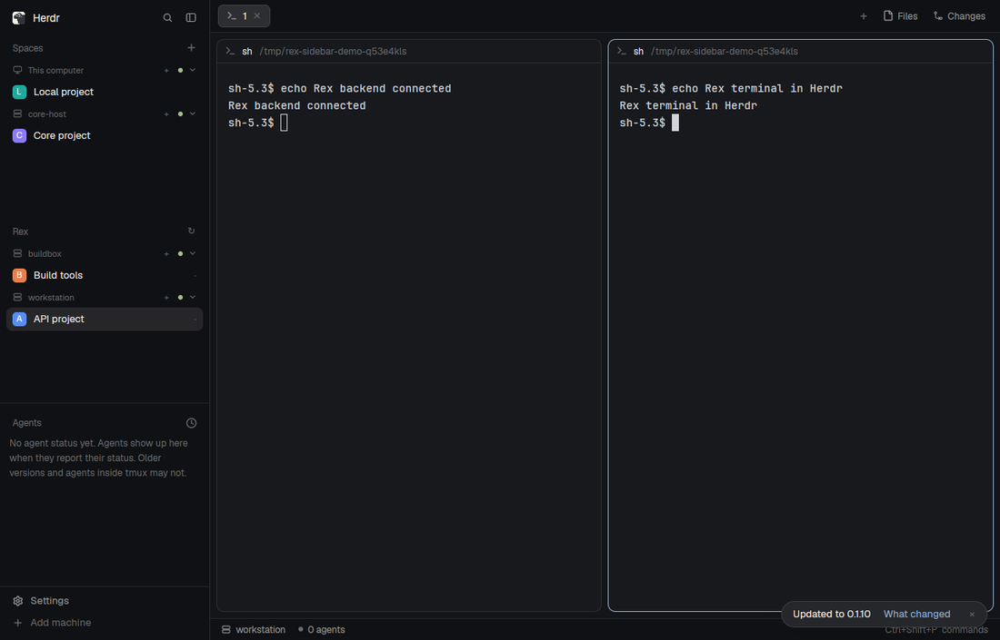

# Rex servers for Herdr

A sidebar section for Rex servers and their spaces, styled like Herdr's ordinary
machine groups. Local and SSH spaces stay in the Spaces section above it. The
person can fold a Rex server, select one of its spaces, and create a new space
without switching the whole window to another backend. Its terminals use
Herdr's existing tabs, panes and terminal renderer.



## What you see

Keep the person's existing sidebar, theme, fonts, agent list and other panels.
Inside its column, place Spaces first, a separate Rex block beneath it, and the
remaining panels after that. Both lists scroll within the space they receive;
do not open a connection dashboard tab or allocate another sidebar column.

The Rex section has a 31px header, a small muted Rex title at the left and a
26px refresh control at the right. Each server uses a compact 26px header:
13px server icon, truncated 11px name, connected-server plus action, 6px
connection dot and 11px fold chevron. Use theme chrome/dim/hover colors; the
connected dot is ansi2 and an unavailable dot is dim. Non-connected states show
the core's short state text beside the name.

Under a server, show 30px space rows with 8px horizontal padding, 8px corners,
a stable colored 18px avatar with 5px corners, and a truncated 13px name. Active
rows use the selected background; other rows use hover on pointer entry. A small
status glyph uses the space's status color. Show a muted empty/unavailable line
when a server has no spaces. A narrow sidebar under 160px uses compact avatars
and icons rather than overflowing labels.

The Spaces section keeps the existing local/SSH presentation, repo information,
worktree grouping, context menus and ordering. Filter Rex groups out of this
view so they are not listed twice. Normal core machines still appear there,
including disconnected ones. No layout file or key snippet ships in the package.

The screenshot shows two private Rex servers and a normal core in an isolated
Herdr window. Its names and terminal text are sample content, not installation
requirements. Icons are simple line server/chevron SVGs; bring no custom fonts.

## How it behaves

Clicking a server header folds its spaces and remembers that per-copy choice.
Its plus action creates a space on that server; refresh rereads the connection
list. Clicking a space selects it; right-click opens Herdr's usual space menu.

Selecting a Rex space opens that server's session without switching Herdr away
from its other machines. The person can type, paste, use terminal mouse modes,
focus, resize, split, rename and close using normal Herdr actions. Changes to
sessions, tabs and terminal splits are real Rex changes and remain shared with
other Rex clients. Connecting and disconnecting must not close sessions or
restart their programs.

Working, blocked, done and idle come from Rex terminal status reports. Publish
them as ordinary core terminal/status events; Herdr applies its own attention
rules, agent colors and completed-work handling. Do not add a separate status
palette or pretend every shell is an agent. Terminal keys and mouse behavior stay with Herdr and the foreground terminal
program. The sidebar uses ordinary hover feedback without global key bindings.

On attachment or reconnect, show the current terminal screen, retained history,
styles, cursor, primary/alternate screen state and input modes before live
output. A session renamed or split from another Rex client updates the same
space. Unknown or removed objects do not become new terminals by accident.
A slow viewer may lose its attachment and reconnect; it must not silently miss
individual output bytes or block unrelated RPC work.

A Herdr mod may sit beside a Rex terminal. It remains a Herdr mod,
with its own props and pane identity. Keep its placement through Rex layout
updates and bridge reconnects without creating a dummy terminal or custom Rex
block. If its terminal anchor disappears, omit the orphaned mod. For a canvas
with no terminal beside it, use a local Herdr mod tab.

## Built from

Build this as an agent-installed package containing the external executable
herdr-rex-bridge and two native JavaScript views, with no layouts/ folder:

```text
mods/rex-bridge/main.js          Rex server and space groups
mods/rex-bridge/mod.json         place: none, title: Rex
mods/rex-bridge/*.svg            server and fold icons
mods/rex-bridge-spaces/main.js   normal Spaces with Rex filtering
mods/rex-bridge-spaces/mod.json  place: none, title: Spaces
```

The Rex view is a default-exported View built with div/svg, v_flex/h_flex and
Herdr's hc, props, run, spaces, shared, setShared, openOverlay and theme APIs.
Read server connections through hc machine ls --json: identify a bridge by its
via flag and rex-prefixed stable core ID, not by a hard-coded machine name.
Ignore temporary machines. Refresh on opening, on the refresh control, and every
15 seconds. Live spaces/theme/shared changes redraw naturally; do not poll them.
Publish sorted server names to shared rex-bridge.servers only when they change.
An optional machine prop filters the Rex view to one registered name. Save folded
server names in this mod copy's localStorage. Use on_size_change for narrow mode.
Run space.select with an explicit ID, space.new with the selected server's name,
and openOverlay with the shipped menu's space target for right-click. Do not
install binaries or register servers as an automatic render side effect.

For the normal Spaces view, copy the stock mod at build/install time and make
a personal filtered version. Hide the Rex provider names published above, filter
Rex machine records from its server headers, and skip their unsupported repo
queries. Keep the original global space indices for drag actions and the full
live ID set for shared color bookkeeping. Never read another mod's source at
runtime or edit Herdr's shipped copy. Use built-in icons for that Spaces view;
ship the Rex view's own SVGs under its mod folder.

The installing agent reads the package, builds the helper, registers endpoints,
and copies both mod folders without overwriting an occupied name. In a personal
layout, point the existing Spaces block to rex-bridge-spaces and add a rex-bridge
block directly below it in the same column. Clone a shipped layout before editing
it. Preserve the other panels, widths, fonts, theme and settings. Let the person
resize the blocks as usual; don't ship or switch to a replacement layout.

The external executable speaks the existing generation-1 hc connect protocol on stdin/stdout
and translates it to Rex API revision 7. Herdr's existing machine transport is
the integration point:

```sh
hc machine add --name rex --via '/absolute/path/herdr-rex-bridge --server unix:///run/user/1000/rex/server.sock via'
```

The bridge's via entry point accepts the remote connect command appended by hc;
it never evaluates or executes that shell line. A direct connect entry point
serves the same protocol for tests. Keep all diagnostics on stderr. The first
hello reply is one JSON line; switch afterward to framed mode when requested.
Give the endpoint a stable core identity. Report protocol compatibility and a
separate bridge version; do not claim to implement every hc operation.

Use the public hc schema and Rex protocols as the wire contracts:

- hc frames have a 9-byte header: little-endian channel u32, kind u8, payload
  length u32. Channel zero carries JSON-RPC. Other channels carry DATA, CREDIT,
  CLOSE, RESIZE, FOCUS and FACTS. Reject payloads over 16 MiB before allocating.
- Support terminal run/list/get/attach/read/label/keep/kill, event subscriptions,
  and the Herdr layout document get/set operations used by the client. Return
  explicit errors for unsupported operations. A hello names supported methods.
- Give each stream an independent credit gate, initially 256 KiB; send chunks
  no larger than 16 KiB. CREDIT replenishes it; CLOSE wakes blocked workers.
  Bound upstream terminal queues. Keep long RPC calls off the reader thread.
- Rex control uses a WebSocket at /api/control with rex.control.v1. Handle
  correlated replies, ordered events, timeouts, disconnects and concurrent
  requests. Data uses /api/data and rex.data.terminal.v1, with resume support.
  Unix sockets, ws and wss endpoints are supported. Use system certificate
  roots for TLS and leave authorization to Rex. Refuse credentials, query
  strings, fragments or arbitrary endpoint paths.
- Split each terminal stream into its initial GHOSTSNP snapshot, live VT bytes
  and nonce-authorized rex1 APC messages. Validate framing, lengths, grid size
  and CRC32C. Reject a corrupt snapshot without handing it to the viewer.
- Restore snapshots with a pinned libghostty-vt, then format them to VT for
  stock Herdr. Preserve the primary shell/history even when attaching inside
  an alternate-screen program. Retain unfinished escape/UTF-8 continuation.
  Do not leave synchronized-output state freezing the new display.
- Rex already answers device queries. Remove those queries before the display
  sees them, including partial sequences crossing reads. Do not enable a
  second source of in-band resize reports. Omit Kitty images,
  including file/shared-memory requests that could address the viewer's files.

Map Rex's session/window/tiled split/block structures into the machine's
herdr-app document. Maintain stable aliases for terminals and pane IDs. Compare
the requested terminal tree with current Rex views and issue a bounded sequence
of real Rex operations, refreshing views after each. Reject stale document
versions. New terminals can wait briefly for a layout to place them, then must
start detached even when a background CLI caller never opens a viewer.

Before planning Rex calls, strip Herdr-only mod branches and return their width
share to the neighboring terminal. Persist the decorations separately with their
terminal anchor, orientation, order, props and sizes. Reapply them to fresh Rex
projections. Do not resize Rex's own split just because a mod was added. Reject
a mod-only Rex tab before mutating the server.

Store aliases, space extras and mod decorations in endpoint-specific JSON under
XDG_STATE_HOME/herdr-rex-bridge, otherwise ~/.local/state/herdr-rex-bridge. Offer
an explicit state-directory override. New metadata fields need defaults so old
state still loads. No settings or documents inside Herdr's installation need a
new schema. No Herdr-specific build, dynamic plugin or GPUI dependency is needed
at runtime; libghostty-vt belongs to the bridge.

One workable source split is hc wire server, Rex control/data transport, stream
decoder, pure layout mapping, snapshot-to-VT conversion, and mod-pane metadata.
Use separate tests for the pure protocol/mapping pieces and the real-server
integration. Build Rust and the pinned Ghostty source with Zig 0.16.0 and Clang.

## Watch out

- This mod requires an external executable. The installing agent must build it,
  register it through hc --via, and place the two sidebar views. Copying only the
  JavaScript does not establish a server connection. Do not change backend/core
  settings or global keys; edit only the person's sidebar placement.
- The bridge connects to a Rex server and reads terminal/session data. User
  input and layout commands are sent to that server. Its metadata is local;
  it starts no Rex server and should never stop or restart somebody else's.
- Linux is tested. macOS is untested; the hc --via transport currently rejects
  Windows. Require the intended Rex API revision rather than guessing around
  protocol mismatches.
- Register each Rex endpoint once. Other Rex hosts need separate ordinary hc
  machine registrations; do not inject nested machine names from Rex's host
  list. Simultaneous independent cores writing the same bridge metadata are
  unsupported.
- Only terminal tiled layers are projected. Keep unknown Rex blocks and floating
  layers safe, but do not claim to display them. Lua client keys/actions are
  not forwarded. General hc exec, remote files/git panels and Kitty images
  are not implemented; expose those limits instead of running them locally.
- A snapshot is binary state, not bytes to print into Herdr. Filtering must be
  streaming and bounded; a partial query or image must not bypass it. Replies
  from the display must not be injected a second time into the real program.
- A saved Herdr mod is not a Rex terminal. Preserve its props as given, keep it
  across a server-side rename, and test a fresh bridge process reading its
  metadata. A temporary in-memory pane is not enough.
- Preserve the original shell and stable addresses on reconnect. Do not rerun
  old commands, launch new shells on every attachment, or reuse an alias still
  bound to a live terminal after a bridge restart.
- Tests must create their own Rex server, core session, app home and headless
  display. Use explicit process handles and shut down only those fixtures.
  Never send fake input on the real display or use a user's live sessions as
  disposable tests.

## Done when

- An unmodified Herdr binary shows a separate Rex section with multiple servers
  and spaces, beside the normal local/SSH Spaces section, with no duplicate Rex
  rows or global backend switcher. The package contains no layouts/ folder.
- Both JavaScript views pass the checker, render in a real isolated window,
  follow light/dark themes, and remain usable at narrow sidebar widths.
- Server folds persist, refresh updates the server list, a space row selects the
  exact space, and the connected-server plus action creates a space there.
- Its normal terminal and layout controls alter an isolated Rex fixture, and
  an external Rex rename/split appears back in Herdr.
- Reconnecting restores existing output, colors, cursor, modes, history and the
  primary shell after leaving an alternate-screen program. No snapshot header
  is displayed as terminal text.
- Keyboard input reaches the selected Rex block; resize and focus reach it;
  device queries and in-band resize reports are not answered twice.
- A background run starts without a viewer and its address remains usable;
  stale document versions fail without changing the server.
- A blocked credit gate affects only that stream, malformed/oversize frames
  are rejected, and closing the stream wakes its waiter.
- A Herdr mod beside the terminal survives an external Rex update and bridge
  reconnect, keeps its project props and creates no extra Rex terminal.
- The live server process and sessions survive removing/reconnecting the hc
  registration. Other registered machines and the user's app settings remain.
- Unit tests, an isolated real Rex/hc smoke test and a headless stock-Herdr
  test pass. The screenshot comes from that isolated app, not a mockup.
